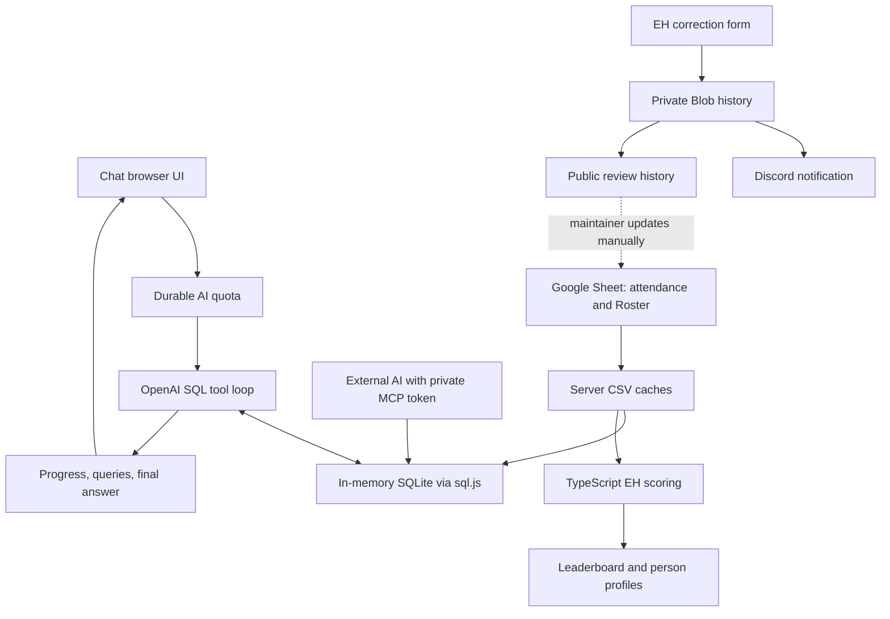

# Architecture

Bedrock Data AI is one Next.js App Router application, written in TypeScript with React and Tailwind CSS. TanStack Query handles browser fetches. Vercel hosts the app; Google Sheets supplies attendance and EH attributions; private Vercel Blob stores correction history and AI usage. There is no permanent SQL attendance database and no automatic sheet writer.

## Three paths through the app

Chat uses AI to query attendance. The leaderboard computes scores directly in TypeScript. MCP lets an external AI query attendance without using this app's OpenAI key. These paths share data helpers but have different eligibility, authentication, and cost rules.

## Routes and UI ownership

`app/page.tsx` owns the chat state, saved conversations, desktop/mobile sidebar, and the home page's Chat/EH tab switch. `/eh-challenge` renders the same leaderboard component on a shareable route. `app/providers.tsx` creates the browser QueryClient. Styling uses `app/globals.css` and Tailwind classes: dark background `#07070f`, purple/blue accents, and the existing mobile sidebar overlay.

| Route | Handler/component | Contract |
| --- | --- | --- |
| `/` | `app/page.tsx` | Public chat and EH tab |
| `/how-it-works` | `app/how-it-works/page.tsx` | Public product explanation |
| `/connect` | `app/connect/page.tsx` | Public connector instructions; no real key in HTML |
| `/eh-challenge` | `app/EhChallenge.tsx` | Public standings, search, sorting, corrections |
| `/eh-challenge/points` | `app/PointsGuide.tsx` | Public infographic; also embedded in leaderboard details |
| `/eh-challenge/person/[name]?period=year` | `app/PersonDetail.tsx` | Encoded-name profile; decoded in the server route |
| `/eh-challenge/corrections` | `app/EhCorrectionHistory.tsx` | Public submission history |
| `POST /api/chat` | `app/api/chat/route.ts` | JSON input, SSE success, JSON validation/quota errors |
| `GET /api/suggestions` | `app/api/suggestions/route.ts` | Static homepage questions |
| `GET /api/eh-challenge?period=month\|year\|all` | `app/api/eh-challenge/route.ts` | Computed `ChallengeResult`; invalid/missing period defaults to year |
| `GET, POST /api/eh-corrections` | `app/api/eh-corrections/route.ts` | Roster names / save-and-notify submission |
| `GET /api/eh-corrections/history` | `app/api/eh-corrections/history/route.ts` | Public review history with current-Roster comparison |
| `POST /api/mcp` | `app/api/mcp/route.ts` | Token-protected JSON-RPC tools |
| `/login`, `POST /api/auth` | Legacy compatibility routes | Redirect to `/` / HTTP 410; no password middleware |

The public favicon assets are `app/icon.svg`, `app/favicon.ico`, and `app/apple-icon.png`. No native mobile app or separate API service is involved.

## Data sources and schema

The source is [F3 Bedrock Data](https://docs.google.com/spreadsheets/d/11fIBnwzcVU2F-OZu7zECq8xROJC6hMY4MryHR4KbUj0/edit).

| Tab | gid | Reader | Used for |
| --- | --- | --- | --- |
| Attendance Master | `729344821` | `lib/attendance-db.ts` | Chat/MCP SQL and challenge workouts |
| Roster | `437240319` | `lib/sheet.ts` | Bedrock eligibility, EH credit, return credit, canonical correction names |

Attendance is exported as CSV and cached in server memory for 10 minutes. SQLite is also reused for 10 minutes per warm instance. Roster CSV has its own one-minute cache. These are per-instance caches, not a shared synchronization service. The browser's challenge query is stale after five minutes and does not poll automatically; a sheet edit need not appear immediately in an already-open page.

`getDatabase()` loads CSV into SQLite through sql.js/WebAssembly. Dates become ISO `YYYY-MM-DD`; numeric flags become integers; blank fields become null. Unparseable dates and years outside 2020–2030 are skipped. Duplicate column headers are renamed; the second `Month` becomes `Month_1`.

| SQLite column | Type | Meaning |
| --- | --- | --- |
| `PAX Name` | TEXT | Recorded F3 name; casing/spelling may vary |
| `Site Name` | TEXT | AO |
| `FNG` | INTEGER | First-time-attendee flag |
| `Post` | INTEGER | Actual workout participation flag |
| `Q` | INTEGER | Led that workout |
| `QS`, `QS-Q` | INTEGER | Qsource participation/leadership flags |
| `Date` | TEXT | ISO workout date |
| `Month`, `Year` | INTEGER | Month number and year |
| `Month_1` | TEXT | Month name |
| `Day of the Week`, `City` | TEXT | Source labels |

Attendance rows may exist when a PAX did not post: filter `Post = 1` when counting workouts. Chat/MCP guidance anchors “last N days” to `MAX(Date)` and asks for exact name lookup before person statistics. The SQL table contains attendance only, not the Roster. Consequently a raw SQL FNG count is not necessarily the region-filtered challenge count.

Roster headers required by the reader are `F3 Name`, `Region`, and `EH'er`. Optional `Brought back by` and `Return date` supply Resurrection credit. Readers use header names rather than fixed column letters. The public correction-name API returns only names and EH attribution, not the rest of the intake information.

## Chat request lifecycle

`app/page.tsx` posts `{ question, history, reasoningLevel }` to `/api/chat`.

1. Validate the request: question 1–2,000 characters, last 12 history messages with valid roles and at most 16,000 content characters, body at most 32,000 characters (plus a preliminary Content-Length check).
2. Reserve quota using `lib/aiRateLimit.ts`, before any OpenAI call. An accepted reservation counts even if the later question fails; there is no refund step.
3. In Auto mode, `gpt-5-nano` selects low/medium/high reasoning. Explicit choices skip classification.
4. Fetch attendance and prepare SQLite. Send the system prompt, recent chat, and question to `gpt-6.1-sol` through the OpenAI Responses API.
5. Run requested SQL and feed results back. Allow at most six model rounds; the sixth disables tools. Each round caps output at 6,000 tokens, including reasoning. Each tool result is truncated to 24,000 characters before returning to the model. Multiple tool calls can occur in a round; six rounds does not mean six SQL statements.
6. If an answer is returned, ask `gpt-5-mini` for follow-up suggestions, capped at 1,024 output tokens. Classifier output is capped at 512. OpenAI client calls use a 60-second timeout and no SDK retries.
7. Send the final answer and suggestions. If no final answer is produced within the loop, return an error asking for a narrower question.

The response is SSE (`data: <JSON>\n\n`) with these application events:

| Event | Fields | Client behavior |
| --- | --- | --- |
| `phase` | `label` | Show progress |
| `query` | `index`, `reason`, `sql` | Record inspectable query details; index identifies the query batch |
| `done` | `answer`, `suggestions`, `reasoningLevel` | Render the completed answer and save the chat |
| `error` | `message` | Show an error |

This streams progress and query events, not answer tokens. The answer arrives in the final event after the follow-up attempt. Validation/quota failures return ordinary JSON HTTP errors before SSE; the client checks `res.ok` first.

Chat executes model SQL through `runSQL()`. The explicit `isReadOnlySelect()` gate is used by MCP, not the chat tool loop. Do not describe that MCP guard as protecting every SQL call. SQL results are evidence for the model, not a correctness guarantee.

Homepage `/api/suggestions` returns six static questions with CDN caching and makes no AI calls. This is separate from paid post-answer follow-ups.

## EH scoring

`/api/eh-challenge` fetches attendance, EH attributions, and return attributions, then calls the pure `computeChallenge()` function in `lib/ehChallenge.ts`. The API and person pages default to `year`; the UI remembers later period choices.

A challenge FNG needs an attendance FNG flag and a matching Roster name whose trimmed, case-insensitive `Region` is Bedrock. Missing/blank/other regions do not qualify. The rest of attendance remains available. Names are compared after trimming, lowercasing, and collapsing whitespace; this is not typo correction.

For each PAX, the earliest eligible FNG date defines when he joined. Month/year selects the cohort joining in that window, rather than merely filtering all earned events by calendar date. All-time begins at the earliest attendance date. `asOf` is the latest parsed attendance date, including rows without a post. Workouts are distinct post dates from the FNG's first date through `asOf`; multiple posts on the same date count once.

| FNG workout | Points to recorded EH'er | Cumulative workout points |
| --- | --- | --- |
| 1 | 5 | 5 |
| 2 | 3 | 8 |
| 3–4 | 0 | 8 |
| 5 | 5 | 13 |
| Each after 5 | 1 | 14 at workout 6; 18 at workout 10 |

A nonblank Roster EH'er is authoritative. With no EH'er, the FNG still appears, but his workout points are unassigned. No correction suggestion or Band research overrides the Roster.

Referral example: You EH Alex; Alex EHs Ben. You receive a +5 upstream referral bonus for Ben, while Alex receives Ben's workout points. Both Alex and Ben must belong to the selected cohort. The code awards this per qualifying downstream FNG, not as an unlimited multigeneration chain.

The configured region goal is 50 FNGs. Weekly points cover the Monday–Sunday week containing `asOf`. Points sorting breaks ties by weekly points, then name. FNG sorting orders by FNG count, total points, weekly points, then name. Search preserves the ranks of the currently selected sort. “Copy for Band” copies the top ten using that sort; it does not post to Band.

### Themed bonuses configured for 2026

| Dates (inclusive) | Theme | Award |
| --- | --- | --- |
| Nov 2–8 | Free for All | Regular scoring; no extra bonus |
| Nov 9–15 | Family Tree | +5 to the inviter for his first recorded FNG |
| Nov 16–22 | Resurrection Week | +5 to the recorded person bringing a PAX back |
| Dec 18–31 | The Christmas Gift | +5 to the EH'er for each qualifying FNG joining in the window |

There are no October themes. Family Tree finds each inviter's earliest FNG across the loaded eligible history, not just the displayed period; it is separate from the upstream referral bonus. Resurrection requires a Bedrock Roster entry with both return fields, a matching recorded post, and at least 180 days since the previous recorded post. It credits `Brought back by`, never guesses from the original EH'er, and credits a returning PAX once per theme. Theme status is based on `asOf`, so a stale sheet can show a theme as upcoming even after the calendar advances.

Person profiles use the same challenge result and selected cohort. `lib/ehProfile.ts` derives badges and the next workout milestone; those displays award no extra points.

## Corrections and Discord

`GET /api/eh-corrections` supplies canonical Roster names. POST requires a UUID-v4 request ID, existing names for the invited PAX, proposed EH'er, and self-reported submitter, plus optional notes of at most 400 characters. It rejects self-EH, validates a honeypot, checks Origin when provided, and checks Content-Length against 4,096 bytes. The origin check is not user authentication.

`saveCorrection()` writes the full record before Discord delivery. Conditional ETag writes retry conflicts up to five times. Reusing a request ID with identical content returns the existing record; reusing it with different content is rejected. A name already matching the Roster is rejected for a new submission.

Delivery claims change notification state from pending/failed to sending, then sent or failed. A sending claim expires after 60 seconds; Discord attempts are bounded to three with timeouts. Mentions are disabled. Failure preserves the saved correction and the UI can retry the same submission. There is no background worker automatically draining failures. A delivery followed by a storage failure can still lead to a later duplicate; this is not an exactly-once delivery system.

Public history returns newest submissions first. “Matches current Roster” is a comparison with today's Roster, not an approval audit trail. Names, notes, previous credit, self-reported submitter, and time are public. No endpoint writes the spreadsheet or applies a correction to scoring.

Chat Discord notifications use a different, process-local, best-effort queue. They include the question, completion summary with up to 500 plain-answer characters, or an error. Do not assume correction delivery durability applies to chat notifications.

## Access, costs, and storage boundaries

| Surface | Access | App OpenAI calls? | Persistent state |
| --- | --- | --- | --- |
| Chat | Public; quota applies | Yes | Hashed-IP usage counters; logs/optional Discord |
| Leaderboard/profiles/points | Public | No | Source sheet; browser period preference |
| Corrections/history | Public; input validation | No | Private Blob backing publicly displayed history |
| MCP POST | Private shared token | No | Uses attendance memory cache |
| Saved chats | This browser | Follow-ups send recent context | Browser localStorage |

`bedrock-conversations` stores chats; `bedrock-suggestions` caches homepage questions; `bedrock-eh-period-v2` stores the period; `bedrock-agent-banner-dismissed` remembers banner dismissal. The menu retains connector and GitHub links. Clearing browser storage clears these preferences and saved chats.

MCP supports JSON-RPC initialization, ping, tool listing/calls, and batches over HTTP POST. Tools are `get_schema`, `run_sql`, and `search_pax`. Auth accepts an exact shared `MCP_TOKEN` in a Bearer header or `?key=`. Missing configuration keeps POST closed with 401. GET returns 405; OPTIONS returns 204. This is a small custom implementation, without user accounts, OAuth, or server-pushed SSE sessions. The public `/connect` page contains placeholders only.

See [operations.md](operations.md) for quota details, Blob initialization, configuration, and troubleshooting.
