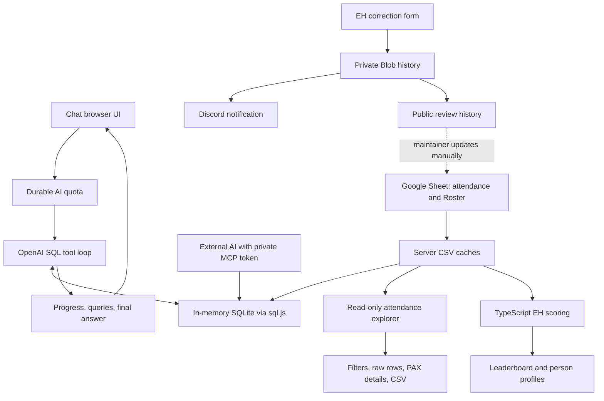

# Architecture

Bedrock Data is one Next.js App Router application, written in TypeScript with React and Tailwind CSS. TanStack Query handles browser fetches. Vercel hosts the app; Google Sheets supplies attendance and EH attributions; private Vercel Blob stores correction history and AI usage. There is no permanent SQL attendance database and no automatic sheet writer.

## Data paths through the app

Chat uses AI to query attendance. The leaderboard computes scores directly in TypeScript. MCP lets an external AI query attendance without using this app's OpenAI key. These paths and the data explorer share data helpers but have different eligibility, authentication, and cost rules.

## Routes and UI ownership

`app/page.tsx` owns the desktop/mobile sidebar and the home page's Chat/EH/Data tab switch. The root `app/ChatSessionProvider.tsx` owns a `lib/chatSession.ts` session across client navigation, including requests, saved conversations, active chat, per-chat drafts, and reasoning preference. `/eh-challenge` renders the same leaderboard component on a shareable route. `app/providers.tsx` creates the browser QueryClient. Styling uses `app/globals.css` and Tailwind classes: dark background `#07070f`, purple/blue accents, and the existing mobile sidebar overlay.

| Route | Handler/component | Contract |
| --- | --- | --- |
| `/` | `app/page.tsx` | Public Chat, EH Challenge, and Data tabs |
| `/data` | `app/DataExplorer.tsx` | Public attendance explorer; also available in the home Data tab |
| `/data/trends` | `app/AttendanceTrends.tsx`, `lib/attendanceTrends.ts` | Attendance-only graphs, up to four AO comparisons, AO growth ranking, turnout by weekday, weekly turnout heatmap |
| `/data/aos?ao=NAME` | `app/AoPages.tsx`, `lib/aoProfile.ts` | AO list (no `ao`) and one AO's turnout over time, growth, top PAX, top Qs, Q draw, biggest workouts, weekdays, FNGs, and a second-AO comparison |
| `/data/milestones` | `app/Milestones.tsx`, `lib/milestones.ts` | Pace-based forecasts for 100, 500, then every 500 (filterable to every 100, 500s, or 1,000s), actual reached milestones |
| `/data/community` | `app/Community.tsx`, `lib/community.ts` | FNG follow-through by month, Roster EH family tree, first-Q candidates, Q ratio among regulars, run-site vs beatdown Q mix |
| `GET /api/data` | `app/api/data/route.ts` | Allowlisted attendance, Roster names/regions/EH credit, and active Sites; no AI calls |
| `/how-it-works` | `app/how-it-works/page.tsx` | Public product explanation |
| `/connect` | `app/connect/page.tsx` | Public connector instructions; no real key in HTML |
| `/eh-challenge` | `app/EhChallenge.tsx` | Public standings, search, sorting, corrections |
| `/eh-challenge/points` | `app/PointsGuide.tsx` | Public infographic; also embedded in leaderboard details |
| `/eh-challenge/person/[name]?period=challenge` | `app/PersonDetail.tsx` | Encoded-name profile; decoded in the server route |
| `/eh-challenge/corrections` | `app/EhCorrectionHistory.tsx` | Public submission history |
| `POST /api/chat` | `app/api/chat/route.ts` | JSON input, SSE success, JSON validation/quota errors |
| `GET /api/suggestions` | `app/api/suggestions/route.ts` | Static homepage questions |
| `GET /api/eh-challenge?period=challenge\|year` | `app/api/eh-challenge/route.ts` | Computed `ChallengeResult`; invalid/missing period defaults to challenge |
| `GET, POST /api/eh-corrections` | `app/api/eh-corrections/route.ts` | Roster names / save-and-notify submission |
| `GET /api/eh-corrections/history` | `app/api/eh-corrections/history/route.ts` | Public review history with current-Roster comparison |
| `/admin/chats` | `app/admin/chats` | Password-protected search and review of private chat records |
| `GET /api/admin/chats`, `POST, DELETE /api/admin/session` | `app/api/admin` | Signed admin sessions and private, uncached history reads |
| `POST /api/mcp/chat-history` | `app/api/mcp/chat-history/route.ts` | Private, read-only chat-history tools; separate bearer token |
| `POST /api/mcp` | `app/api/mcp/route.ts` | Token-protected JSON-RPC tools |
| `/login`, `POST /api/auth` | Legacy compatibility routes | Redirect to `/` / HTTP 410; no password middleware |

The public favicon assets are `app/icon.svg`, `app/favicon.ico`, and `app/apple-icon.png`. No native mobile app or separate API service is involved.

## Data sources and schema

The source is [F3 Bedrock Data](https://docs.google.com/spreadsheets/d/11fIBnwzcVU2F-OZu7zECq8xROJC6hMY4MryHR4KbUj0/edit).

| Tab | gid | Reader | Used for |
| --- | --- | --- | --- |
| Attendance Master | `729344821` | `lib/attendance-db.ts` | Chat/MCP SQL and challenge workouts |
| Sites | Named CSV export (`sheet=Sites`) | `lib/dataExplorerSource.ts` | Current active AO names/cities and coverage denominator |
| Roster | `437240319` | `lib/sheet.ts` | Bedrock eligibility, EH credit, return credit, canonical correction names |

Attendance is exported as CSV and cached in server memory for 10 minutes. SQLite is also reused for 10 minutes per warm instance. Roster CSV has its own one-minute cache. These are per-instance caches, not a shared synchronization service. The EH views show “Today's data has not been logged by Commz Q” when `sourceAsOf` is earlier than the current Pacific calendar day. This notice uses source freshness rather than the challenge scoring cutoff; it clears when today’s source data is loaded. The browser's challenge query is stale after five minutes and does not poll automatically; a sheet edit need not appear immediately in an already-open page.

`getDatabase()` loads CSV into SQLite through sql.js/WebAssembly. Dates become ISO `YYYY-MM-DD`; numeric flags become integers; blank fields become null. Unparseable dates and years outside 2020–2030 are skipped. Duplicate column headers are renamed; the second `Month` becomes `Month_1`.

| SQLite column | Type | Meaning |
| --- | --- | --- |
| `PAX Name` | TEXT | Recorded F3 name; casing/spelling may vary |
| `Site Name` | TEXT | AO |
| `FNG` | INTEGER | First-time-attendee flag |
| `Post` | INTEGER | Actual workout participation flag |
| `Q` | INTEGER | Led that workout |
| `QS`, `QS-Q` | INTEGER | Qsource participation/leadership flags |
| `Date` | TEXT | ISO workout date |
| `Month`, `Year` | INTEGER | Month number and year |
| `Month_1` | TEXT | Month name |
| `Day of the Week`, `City` | TEXT | Source labels |

Attendance rows may exist when a PAX did not post: filter `Post = 1` when counting workouts. Chat/MCP guidance anchors “last N days” to `MAX(Date)` and asks for exact name lookup before person statistics. The SQL table contains attendance only, not the Roster. Consequently a raw SQL FNG count is not necessarily the region-filtered challenge count.

Roster headers required by the reader are `F3 Name`, `Region`, and `EH'er`. Optional `Brought back by` and `Return date` supply Resurrection credit. Readers use header names rather than fixed column letters. The public correction-name API returns only names and EH attribution, not the rest of the intake information.

## Attendance explorer

`lib/dataExplorerSource.ts` combines the existing attendance cache, a public-field Roster reader, and the existing Sites tab (`gviz/tq?tqx=out:csv&sheet=Sites`). The assembled snapshot is cached for one minute per warm instance, with concurrent loads sharing a promise; HTTP caching adds up to one minute. Attendance retains its existing ten-minute cache. Phone tables keep the first column pinned at 104px, with full names wrapping and the other columns horizontally scrollable. The browser query is stale after five minutes and refetches on page load or when the tab regains focus; there is no reload button, and refetches read through these caches rather than forcing a Google Sheets refresh. Failed loads return 503 without source details and are not cached.

`lib/dataExplorer.ts` supplies quoted/multiline CSV parsing, date validation, allowlisted fields, combined filters, PAX statistics, shared-workout counts, and formula-safe CSV export. Attendance exposes only PAX, AO, city, date, and Post/Q/FNG/QS/QS-Q flags. The Roster exposes only F3 name, Region, and EH’er. Names containing `(Archived)` or `(<18)` are excluded before serialization, including EH attribution labels. No contact/intake fields or Sites phone numbers leave the server.

Views are PAX, Qsource, Kotter, Q Kotter, monthly AOs, and raw attendance. The initial period is the latest attendance year. View/date/AO/region/search/flag filters are serialized in the URL; `/data` is the canonical share link. Exports include all filtered rows in selected sort order, not only the visible page. PAX detail retains the explorer filters and always describes all-time attendance. Its attendance card swipes between Month (calendar), Year (twelve mini months; tapping one opens it in Month), and Over time (posts and Qs per month from the first recorded post through `asOf`; the monthly average leaves out the partial current month).

Workout summaries count `Post = 1`; Qsource counts `QS = 1` and `QS-Q` leadership. Multiple workouts on one day count separately as posts. Post percentage counts distinct attended dates divided by recorded workout dates in the selected period/AO; all-time denominators start at the PAX’s first recorded post at the selected AO, before flag filtering. Search, region, and flags do not shrink opportunity dates. Streaks count consecutive recorded workout dates, ignoring dates without workouts. First-in-view is not a region-qualified FNG date. Raw FNG flags remain raw; challenge eligibility is unchanged.

Kotter requires Bedrock Roster region, excludes names containing `2.0`, and requires more than 14 and fewer than 365 days since the latest recorded post. Q Kotter requires Bedrock and a recorded Q more than 30 and fewer than 365 days ago. Both use complete history for eligibility and the snapshot’s latest attendance date as their clock, while displayed counts follow the filters. These deliberate rules differ from the reference project’s wall-clock thresholds.

AO coverage uses current active Sites (`Active` status text or Y), not all historical locations. Retired/other locations contribute posts but not coverage. The Sites sheet’s Y marker means active; the reference backend’s inverted retired mapping is not used. Shared workouts match date and AO and deduplicate each companion per workout. Post-range and Q relationship filters apply before counting. Milestones measure each block of 100 recorded workout posts separately.

### Trends and milestone forecasts

Data pages share `app/DataPageShell.tsx`, `app/DataSectionNav.tsx`, and the `lib/useExplorerData.ts` browser query/cache. Trends and milestones reuse `/api/data`; they add no external calls, AI, persistent storage, or sheet writes. The attendance explorer’s PAX profiles link to the matching milestone forecast.

Trends group public `Post = 1` rows into workouts by date + AO. Turnout counts distinct normalized PAX per workout; post totals retain source rows. Region average turnout is weighted by workouts. Unique PAX deduplicates names across the selected weeks/AOs. Compare up to four AOs over the same 13/26/52 Monday–Sunday weeks. The final week ends at `asOf`; weeks without records remain gaps, not claimed zero turnout. The heatmap always shows average turnout and links to raw attendance for that AO/week. AO names in the growth list and heatmap open the AO page. “Clear AOs and show whole region” removes the comparison, closes the panel, and scrolls to the graph; it is disabled when no AO is selected.

AO growth compares each AO’s average turnout in the selected weeks with the same number of weeks just before; a percentage needs at least three workouts in both windows, and an AO with no earlier workouts is “New.” Compare on a growth row adds that AO to the graph (still up to four). Turnout by day averages distinct PAX per workout for each weekday over the selected weeks and AO selection.

The attendance page’s “Last 7 days” strip compares the seven days ending at `asOf` with the seven before: posts, unique PAX, Bedrock FNGs (same rule as the challenge), and the AO with the highest average turnout. The PAX view’s “Last 12 wks” column shows posts in trailing 7-day buckets ending at `asOf`, following the AO filter but not the period; it is sortable and exported.

Milestone totals include all recorded workout posts, including multiple posts on one day, but not Qsource-only attendance. The default milestones are 100, 500, 1,000, then every 500 (`step=major`); filters can instead use every 100, 500s only, or 1,000s only. Old links with `step=100|500|1000` keep that interval. Exact multiples of 1,000 receive the strongest emphasis, then other multiples of 500. Actual reached dates come from the corresponding numbered post.

Forecasts divide the remaining posts by the 90-day posts-per-calendar-day rate, using a shorter denominator for PAX whose first recorded post was more recent. No forecast date is returned with fewer than four posts in the inclusive 90-day window, fewer than 14 days of observation, or no post in the inclusive 30-day window. Earlier/later dates compare 30-day and 90-day pace; they are not statistical confidence bounds or schedule predictions. Forecast windows, recent periods, and timelines follow `asOf`, never the wall clock. Counts are this sheet’s recorded history, not a claim about lifetime posts outside it. Search, milestone interval, period, region, and AO selections persist in page URLs.

### Community

`/data/community?tab=fngs|tree|q` reuses `/api/data` with no AI, storage, or sheet writes, and awards no points. FNG follow-through groups Bedrock FNGs (earliest FNG-flagged row plus Bedrock Roster region, as in the challenge) by FNG month and counts distinct post dates from the FNG date through `asOf`; “still posting” means a post in the last 30 days, and the latest attendance month and the one before are marked “Still early.” Under-18 names are absent from the public snapshot, so totals can be lower than the EH Challenge’s region FNG count.

The family tree uses Roster `EH'er` exactly as written, matched by normalized name like the leaderboard. An unmatched spelling becomes its own root; loops are broken rather than followed. Names with public posts link to their profiles.

Ready for a first Q lists PAX with no recorded Q, 10+ posts, and 2+ posts in the 30 days ending `asOf`, excluding 2.0s, with the AO they posted at most in the last 90 days. Q ratio among regulars covers PAX with 13+ posts in the 90 days ending `asOf` (recorded Qs ÷ posts in that window). Region is not required for either list because most regulars have a blank Roster region.

The run-site vs beatdown section uses AO types supplied by the region in `lib/community.ts` (`AO_KINDS`): Pinnacle, Rattlesnake Ridge, and Trailhead are run sites; Spartan, Divento, Grizzly Bar, Asylum, The Great Awakening, Outpost, Hilltop, and Excelsior are beatdowns. Unlisted AOs (for example CSAUP) count as neither. It lists Qs with 2+ run-site Qs and no beatdown Q in the 365 days ending `asOf` (with their last beatdown Q from all history) and a Q mix table for Qs with 3+ typed Qs in that window, counting each Q once per date and AO.

### AO pages

`/data/aos` lists AOs from recorded workouts with type, usual weekdays (2+ workouts on that weekday in the last 13 weeks), Sites city (placeholders such as `NA` hidden), and 13-week average turnout. AOs the Sites tab marks inactive, or with no workout in 90 days, are grouped separately. `/data/aos?ao=NAME&weeks=13|26|52|all&metric=…&vs=OTHER&chart=yoy&year=YYYY` shows one AO for the selected Monday–Sunday weeks ending `asOf`: totals, turnout change versus the same number of weeks before (3+ workouts in both windows; not shown for all time), a weekly graph with an optional second AO, a Year over year view (Jan 1 through `asOf` compared with the same dates last year, or whole years for past years; Feb 29 maps to Feb 28; percent changes need 3+ workouts in both years; FNGs show the count difference; the monthly chart shows all of last year, and the second AO appears as its own year-over-year change), swipeable Top PAX (distinct dates and share of the AO’s workouts), Top Qs, Best draw (average turnout at workouts each PAX Q’d, 2+ Qs), and Biggest workouts, plus turnout by weekday and Bedrock FNGs whose first FNG row was at this AO. It reuses `/api/data` with no AI, storage, or sheet writes.

## Chat request lifecycle

`lib/chatSession.ts`, through the root chat provider, posts `{ question, conversationId, history, reasoningLevel }` to `/api/chat`. It saves the question and pending state before fetching. Client navigation keeps the session and SSE reader alive; switching chats cannot redirect an answer into another conversation. Deleting a chat aborts its local request and ignores late events, but does not delete server logs or refund quota. Reloading restores the active chat and drafts, converts a saved pending request into an interruption message, and never automatically retries. A stream ending without a terminal event becomes a saved error.

1. Validate the request: question 1–2,000 characters, last 12 history messages with valid roles and at most 16,000 content characters, body at most 32,000 characters (plus a preliminary Content-Length check).
2. Reserve quota using `lib/aiRateLimit.ts`, before any OpenAI call. An accepted reservation counts even if the later question fails; there is no refund step.
3. In Auto mode, `gpt-5-nano` selects low/medium/high reasoning. Explicit choices skip classification.
4. Fetch attendance and prepare SQLite. Send the system prompt, recent chat, and question to `gpt-6.1-sol` through the OpenAI Responses API.
5. Run requested SQL and feed results back. Allow at most six model rounds; the sixth disables tools. Each round caps output at 6,000 tokens, including reasoning. Each tool result is truncated to 24,000 characters before returning to the model. Multiple tool calls can occur in a round; six rounds does not mean six SQL statements.
6. If an answer is returned, ask `gpt-5-mini` for follow-up suggestions, capped at 1,024 output tokens. Classifier output is capped at 512. OpenAI client calls use a 60-second timeout and no SDK retries.
7. Send the final answer and suggestions. If no final answer is produced within the loop, return an error asking for a narrower question.

The response is SSE (`data: <JSON>\n\n`) with these application events:

| Event | Fields | Client behavior |
| --- | --- | --- |
| `phase` | `label` | Show progress |
| `query` | `index`, `reason`, `sql` | Record inspectable query details; index identifies the query batch |
| `done` | `answer`, `suggestions`, `reasoningLevel` | Render the completed answer and save the chat |
| `error` | `message` | Show an error |

This streams progress and query events, not answer tokens. The answer arrives in the final event after the follow-up attempt. Validation/quota failures return ordinary JSON HTTP errors before SSE; the client checks `res.ok` first.

Chat executes model SQL through `runSQL()`. The explicit `isReadOnlySelect()` gate is used by MCP, not the chat tool loop. Do not describe that MCP guard as protecting every SQL call. SQL results are evidence for the model, not a correctness guarantee.

Homepage `/api/suggestions` returns six static questions with CDN caching and makes no AI calls. This is separate from paid post-answer follow-ups.

## EH scoring

`/api/eh-challenge` fetches attendance, EH attributions, and return attributions, then calls the pure `computeChallenge()` function in `lib/ehChallenge.ts`. The API and person pages default to `challenge`, which is listed first; the UI remembers later period choices. `parsePeriod()` in `lib/ehChallenge.ts` accepts only `year` and `challenge`; legacy `month`/`all` links and saved preferences fall back to `challenge`. Shared links may specify `?period=challenge`; profiles and the return link preserve that selection.

A challenge FNG needs an attendance FNG flag and a matching Roster name whose trimmed, case-insensitive `Region` is Bedrock. Missing/blank/other regions do not qualify. The rest of attendance remains available. Names are compared after trimming, lowercasing, and collapsing whitespace; this is not typo correction.

For each PAX, the earliest eligible FNG date defines when he joined. `challenge` selects FNGs joining Oct 15–Dec 31, 2026, inclusive; earlier FNGs cannot earn competition points from later attendance. Its `asOf` is capped at Dec 31 so later workouts and referrals cannot count. `sourceAsOf` always reports the latest parsed attendance date, including rows without a post; `end` reports Dec 31 for the challenge. Before opening day the challenge cohort is empty. Workouts are distinct post dates from the FNG's first date through `asOf`; multiple posts on the same date count once.

This Year contains invitation/retention stats with `scoringEnabled: false`: point totals, breakdowns, and unassigned points are zero. This view does not display point badges, score breakdowns, or a competition ranking. It selects FNGs joining in the year anchored to the latest attendance date. 2026 Challenge is the default view. The point schedule below applies only to the explicit challenge view.

| FNG workout | Points to recorded EH'er | Cumulative workout points |
| --- | --- | --- |
| 1 | 5 | 5 |
| 2 | 3 | 8 |
| 3–4 | 0 | 8 |
| 5 | 5 | 13 |
| Each after 5 | 1 | 14 at workout 6; 18 at workout 10 |

A nonblank Roster EH'er is authoritative. With no EH'er, the FNG still appears, but his workout points are unassigned. No correction suggestion or Band research overrides the Roster.

Referral example: You EH Alex; Alex EHs Ben. You receive a +5 upstream referral bonus for Ben, while Alex receives Ben's workout points. Both Alex and Ben must belong to the Oct 15–Dec 31 challenge cohort. The code awards this per qualifying downstream FNG, not as an unlimited multigeneration chain.

The annual goal is 100 FNGs; the challenge goal is 50. Double Down means two FNGs at one workout and normal points only: two first posts earn 10 total. No extra award or separate tracking is implemented. Weekly points cover the Monday–Sunday week containing `asOf`. Points sorting breaks ties by weekly points, then name. FNG sorting orders by FNG count, total points, weekly points, then name. Search preserves the ranks of the currently selected sort. “Copy for Band” copies the top ten using that sort; it does not post to Band.

### Provisional themed bonuses configured for 2026

Clove’s exact weekly calendar, whether other themes add bonus points, and the three-month Resurrection definition/window await confirmation. The existing configuration below is retained; dates are labeled provisional in the UI and copied standings. Do not treat this table as a newly approved calendar.

| Dates (inclusive) | Theme | Award |
| --- | --- | --- |
| Nov 2–8 | Free for All | Regular scoring; no extra bonus |
| Nov 9–15 | Family Tree | +5 to the inviter for his first recorded FNG |
| Nov 16–22 | Resurrection Week | +5 to the recorded person bringing a PAX back |
| Dec 18–31 | The Christmas Gift | +5 to the EH'er for each qualifying FNG joining in the window |

There are no October themes. Family Tree finds each inviter's earliest FNG across the loaded eligible history, not just the displayed period; it is separate from the upstream referral bonus. Resurrection requires a Bedrock Roster entry with both return fields, a matching recorded post, and at least 180 days since the previous recorded post. It credits `Brought back by`, never guesses from the original EH'er, and credits a returning PAX once per theme. Theme status is based on `asOf`, so a stale sheet can show a theme as upcoming even after the calendar advances.

Person profiles use the same challenge result and selected cohort. `lib/ehProfile.ts` derives badges and the next workout milestone; those displays award no extra points.

## Corrections and Discord

`GET /api/eh-corrections` supplies canonical Roster names. POST requires a UUID-v4 request ID, existing names for the invited PAX, proposed EH'er, and self-reported submitter, plus optional notes of at most 400 characters. It rejects self-EH, validates a honeypot, checks Origin when provided, and checks Content-Length against 4,096 bytes. The origin check is not user authentication.

`saveCorrection()` writes the full record before Discord delivery. Conditional ETag writes retry conflicts up to five times. Reusing a request ID with identical content returns the existing record; reusing it with different content is rejected. A name already matching the Roster is rejected for a new submission.

Delivery claims change notification state from pending/failed to sending, then sent or failed. A sending claim expires after 60 seconds; Discord attempts are bounded to three with timeouts. Mentions are disabled. Failure preserves the saved correction and the UI can retry the same submission. There is no background worker automatically draining failures. A delivery followed by a storage failure can still lead to a later duplicate; this is not an exactly-once delivery system.

Public history returns newest submissions first. “Matches current Roster” is a comparison with today's Roster, not an approval audit trail. Names, notes, previous credit, self-reported submitter, and time are public. No endpoint writes the spreadsheet or applies a correction to scoring.

Chat Discord notifications use a different, process-local, best-effort queue. They include the question, completion summary with up to 500 plain-answer characters, or an error. Do not assume correction delivery durability applies to chat notifications.

## Access, costs, and storage boundaries

| Surface | Access | App OpenAI calls? | Persistent state |
| --- | --- | --- | --- |
| Chat | Public; quota applies | Yes | Hashed-IP usage counters; logs/optional Discord |
| Data explorer | Public | No | Source sheet; memory/HTTP caches; share filters in URL |
| Leaderboard/profiles/points | Public | No | Source sheet; browser period preference |
| Corrections/history | Public; input validation | No | Private Blob backing publicly displayed history |
| MCP POST | Private shared token | No | Uses attendance memory cache |
| Saved chats | This browser | Follow-ups send recent context | Browser localStorage |

`bedrock-conversations` stores chats and pending state; `bedrock-chat-session` stores the active chat, drafts, and reasoning preference; `bedrock-suggestions` caches homepage questions; `bedrock-eh-period-v3` stores the period; its new key resets the old annual preference once so existing visitors receive the challenge default. Explicit `?period=year` links and subsequent choices are still honored; `bedrock-agent-banner-dismissed` remembers banner dismissal. The menu retains connector and GitHub links. Clearing browser storage clears these preferences and saved chats.

MCP supports JSON-RPC initialization, ping, tool listing/calls, and batches over HTTP POST. Tools are `get_schema`, `run_sql`, and `search_pax`. Auth accepts an exact shared `MCP_TOKEN` in a Bearer header or `?key=`. Missing configuration keeps POST closed with 401. GET returns 405; OPTIONS returns 204. This is a small custom implementation, without user accounts, OAuth, or server-pushed SSE sessions. The public `/connect` page contains placeholders only.

See [operations.md](operations.md) for quota details, Blob initialization, configuration, and troubleshooting.

## Persistent chat history

`lib/chatLogStore.ts` uses a small shared MongoDB connection pool and stores one `bedrock_ai.chat_logs` record per accepted question. A pending record is awaited before analysis; a final success/error record is awaited before sending the result. Records include full questions/answers, recent context, SQL, reasoning level, timing, and timestamps. Logging failures emit a credential-free warning and do not block answers. Interrupted work may remain pending. No raw IP is stored in these records, and browser history remains separate.

`/admin/chats` uses the independent `CHAT_ADMIN_PASSWORD` and signed HttpOnly cookies. The private MCP endpoint `/api/mcp/chat-history` requires `CHAT_HISTORY_MCP_TOKEN` in the Authorization header; neither the attendance token, admin password, nor URL keys grant access. Its five fixed read-only tools expose schema guidance, text/date/status search, chronological conversations, complete request records, and count/daily/repeated-question summaries. There is no arbitrary MongoDB query or write tool, and these lookups do not call OpenAI. Transcript strings are untrusted data; anonymous conversation IDs do not identify people. See the README for pagination and summary limits.
